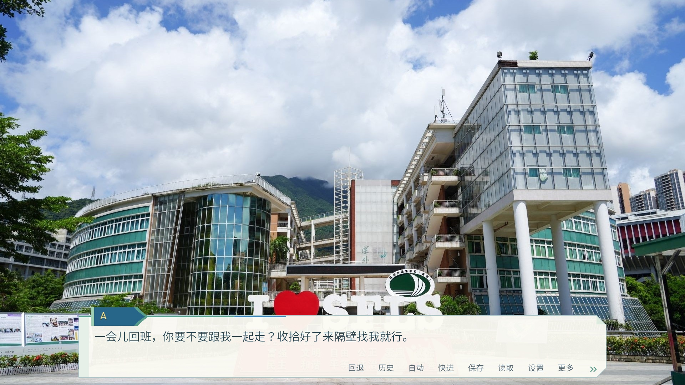
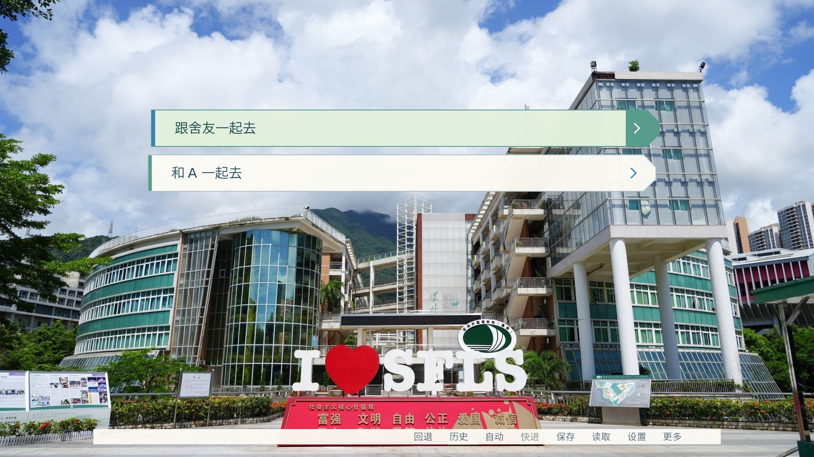

# 游戏内 UI：青春校园版

对话使用米白纸张卡片、蓝绿姓名签与斜切箭头，延续校园照片和主菜单的几何元素。文字、姓名、菜单选项均为 Ren’Py 原生文本；SVG 只包含背景和装饰。主菜单、设置页、剧情、人物变量及现有素材不改动。




预览由 Ren’Py 8.5.3 软件渲染生成。照片使用仓库已有的主菜单照片作可读性测试；正式第一章仍使用原有的纯色占位镜头，待摄影素材准备好再替换。

## 修改位置

- `game/screens.rpy`：只修改 `say` 和 `choice`。保留 `window/namebox/who/what` ID；用 `prefer_screen_to_id` 保证 Character 的默认样式不会覆盖校园布局，角色姓名颜色仍保留。
- `game/gameplay_ui.rpy`：所有游戏内尺寸、配色、排版、触摸变体与选项悬停动作。
- `game/gui/campus/`：六个独立 SVG（textbox、namebox、choice idle/hover/insensitive、继续箭头）。
- `tests/campus_ui_qa.rpy`：非发布目录中的测试用例，仅在隔离测试副本中临时复制到 `game/`。
- 本文及 `docs/ui-preview/`：说明与实际引擎预览。

`gui.rpy` 的 1920×1080 虚拟画布与现有字体路径保持不变。中文使用项目的 SourceHanSansLite，Latin/Latin-1 字符使用 Ren’Py 自带 DejaVu Sans，解决中间点等缺字问题，不引入新字体文件。

## 尺寸与阅读

桌面对话卡宽 1480（画面约 77%），最低高 176，正文 32、姓名 26。高度由正文换行自然扩展，普通台词不预留四行空白；快捷菜单放入卡片下缘，使用透明背景，不再另占一条横栏。small 变体卡宽 1640、最低高 208，正文 38、姓名 32；touch 使用更大的按钮和五个入口，完整工具仍可通过“菜单/更多”访问。所有尺寸使用虚拟像素，窗口按引擎规则等比缩放。

姓名签按姓名长度扩展，最长宽 1040。正文已验证四行中文，卡片在长段落时才向上扩展，底部为快捷操作保留独立空间；继续箭头位于右下方。更长段落应拆成多次对话，避免占用整幅照片。选项自动换行，少量选项居中，大量选项在上方照片区域滚动，可用滚轮、Page Up/Down 和触摸拖动。

正文与米白底的静态对比度约 9.32:1，普通/悬停选项约 7.66:1 / 7.83:1。半透明底保持较高不透明度，让亮天、树叶和建筑照片不干扰阅读。数值针对指定底色，不代表任意透明合成背景的完整无障碍认证。

## 复现检查

使用 Ren’Py 8.5.3 SDK。在新的测试副本中，从项目根目录运行：

```sh
cp tests/campus_ui_qa.rpy game/zz_campus_qa.rpy
/path/to/renpy-sdk/renpy.sh "$PWD" test campus_ui_qa --overwrite-screenshots --savedir "$PWD/test-saves"
```

无显示器环境可使用：

```sh
SDL_VIDEODRIVER=dummy SDL_AUDIODRIVER=dummy RENPY_RENDERER=sw RENPY_SCALE_FACTOR=1 /path/to/renpy-sdk/renpy.sh "$PWD" test campus_ui_qa --overwrite-screenshots --savedir "$PWD/test-saves"
```

设置 `RENPY_SCALE_FACTOR=0.666666667` 可检查 1280×720 捕获；用 `RENPY_VARIANT="small touch mobile"` 和 `RENPY_SCALE_FACTOR=0.5` 检查 960×540 触摸布局。截图默认写入 `tests/screenshots`，可用 `SFLS_UI_QA_OUTPUT` 指定绝对输出目录。测试结束后删除临时的 `game/zz_campus_qa.rpy` 及对应的 `.rpyc`；测试副本及存档不用于正式发布。

测试脚本在 SDL dummy 环境中使用周期刷新和独立 RGBA 软件捕获缓冲，解决该环境的停帧及截图像素格式问题。这些适配只存在于测试目录，不修改 Ren’Py SDK 或游戏运行代码。

紧凑修订验证了短台词的卡片高度、透明框内快捷栏，以及长文本不侵入按钮区域。

已完成：Ren’Py lint、资源格式检查、差异空白检查；桌面 1920×1080、缩放 1280×720、small/touch 960×540 的四个运行用例；两条实际剧情分支；快速保存/读取、保存页、设置、历史、自动模式、隐藏界面；长姓名、四行正文、长选项与八项菜单滚动。

未完成：硬件 OpenGL/GPU、Windows、真实 Android/iOS 设备及最终剧情摄影素材测试。命令行图形启动无法取得显示器，故使用软件渲染验证。请在目标设备上复核实际触摸与字体显示后再发布。
